<div align="center">


# EchoScribe

**Session notes you can check.** Every sentence cites the transcript turns that support it, and a different model verifies it.

[](https://github.com/Aravind-Krishnan-S/ECHOSCRIBE/actions/workflows/ci.yml)
[](LICENSE)
[](https://nodejs.org)
[](https://react.dev)
[](https://www.typescriptlang.org)
[](https://supabase.com)
[](https://huggingface.co/pyannote-community/speaker-diarization-community-1)
[](src/services/provider-catalog.js)
[](#model-providers)

<br />

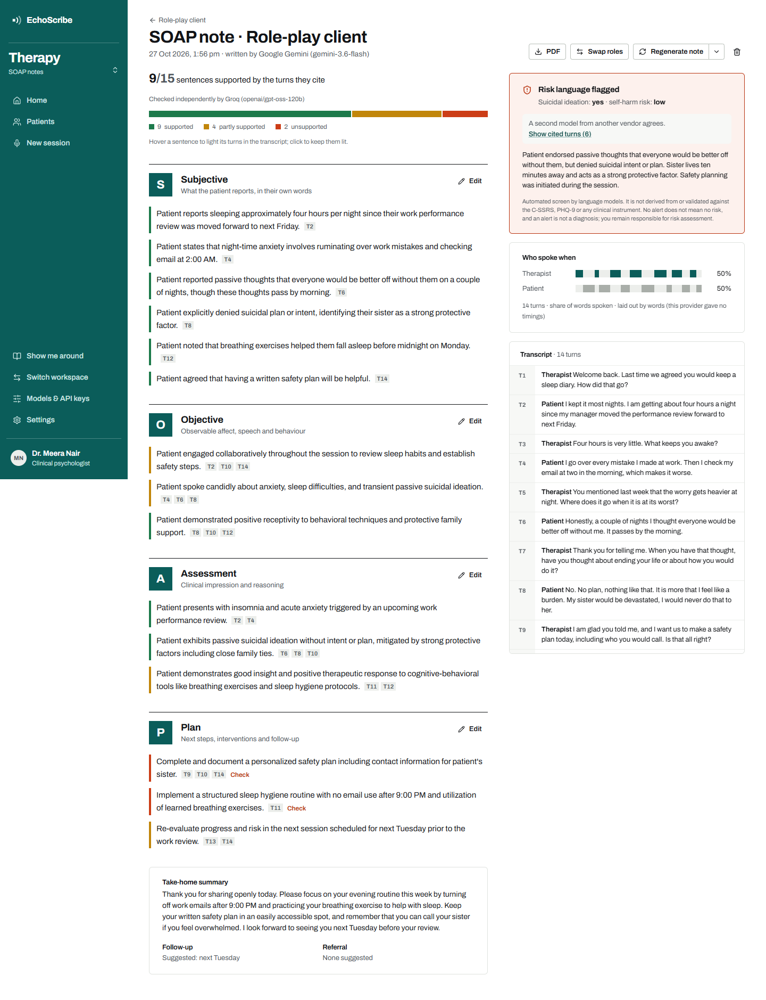

</div>

---

## Why EchoScribe

Language models can draft a therapy or mentoring note from a recording, but a draft may state things the session never
contained, and a reviewer cannot tell which sentence rests on what. A single cloud model is also a single point of failure:
a quota, an outage or a retired model stops documentation altogether.

EchoScribe turns a recorded two-person session into a **SOAP** (therapy) or **GROW** (mentoring) note in which:

- **every sentence cites the turns that support it** (`[T4, T6]`), so the reviewer can see the evidence;
- **a model other than the writer checks each sentence** against only its cited turns, from another vendor when one is configured;
- **failing notes are regenerated** on another model, and flagged sentences are repaired from the transcript or removed;
- **an embedded router keeps every step available** through quota exhaustion, outages and revoked keys;
- **speakers are separated locally** on the original recording, and each word is assigned to a speaker by its timestamp.

> EchoScribe is research software, not a medical device. Risk flags are model-reported and uncalibrated, and the clinician
> remains responsible for every assessment. See [Responsible use](#responsible-use).

## Screens

<table>
  <tr>
    <td width="50%">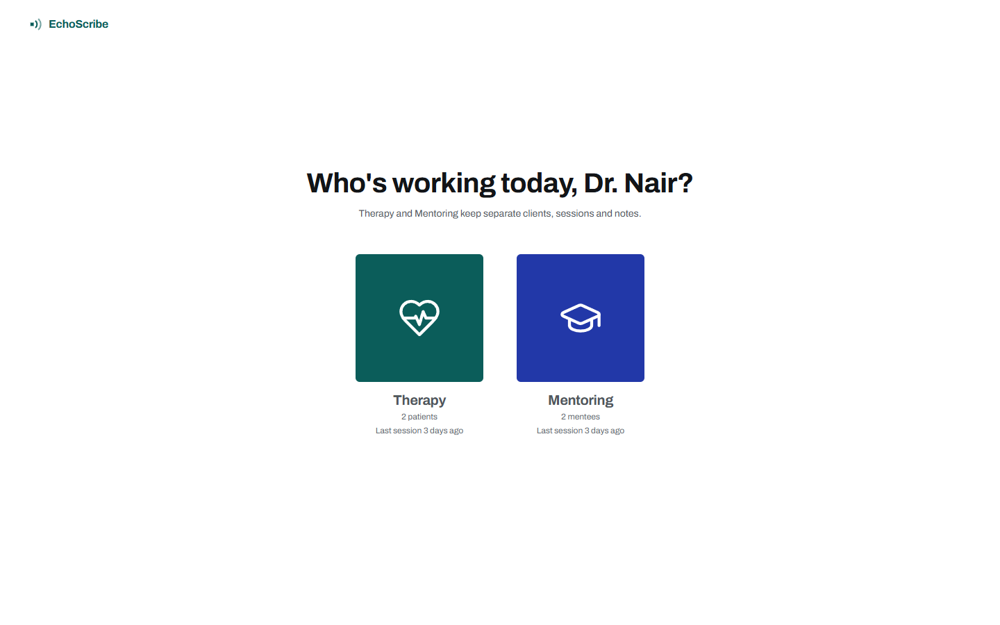<br /><sub><b>Two workspaces.</b> Therapy and Mentoring keep separate clients, sessions and notes.</sub></td>
    <td width="50%"><br /><sub><b>Home.</b> Recent sessions, risk alerts and a getting-started checklist.</sub></td>
  </tr>
  <tr>
    <td>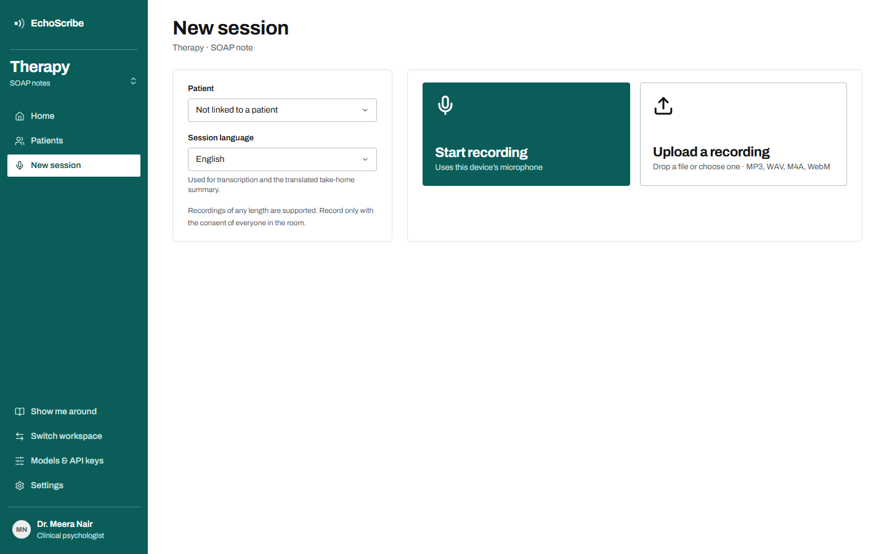<br /><sub><b>Record or upload</b> a session in the browser.</sub></td>
    <td>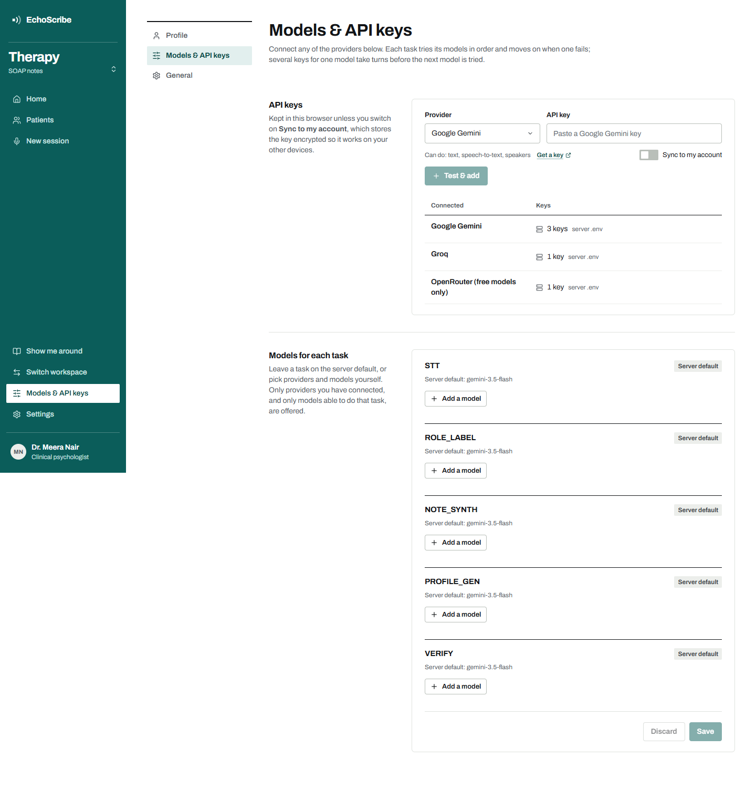<br /><sub><b>Models &amp; API keys.</b> Add a key, test it, choose models per role. Keys stay in the browser unless you sync one.</sub></td>
  </tr>
  <tr>
    <td>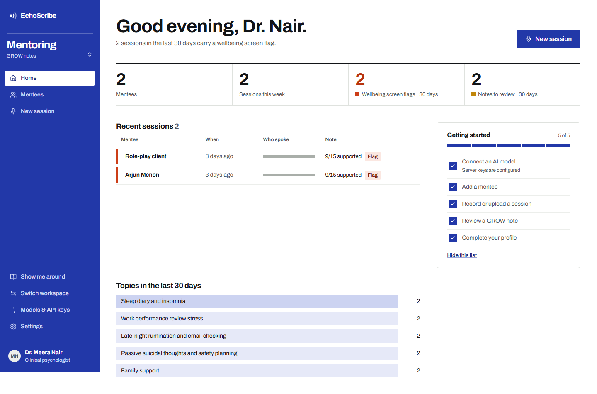<br /><sub><b>Mentoring workspace.</b> The same home screen for mentors, with mentees instead of patients.</sub></td>
    <td>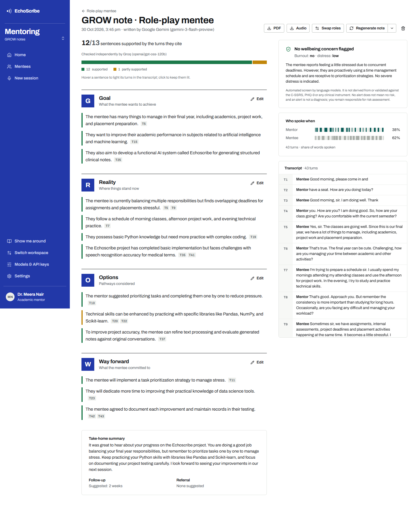<br /><sub><b>GROW notes.</b> Goal, Reality, Options and Way forward, each sentence cited and verified (pipeline output on a role-played session).</sub></td>
  </tr>
  <tr>
    <td>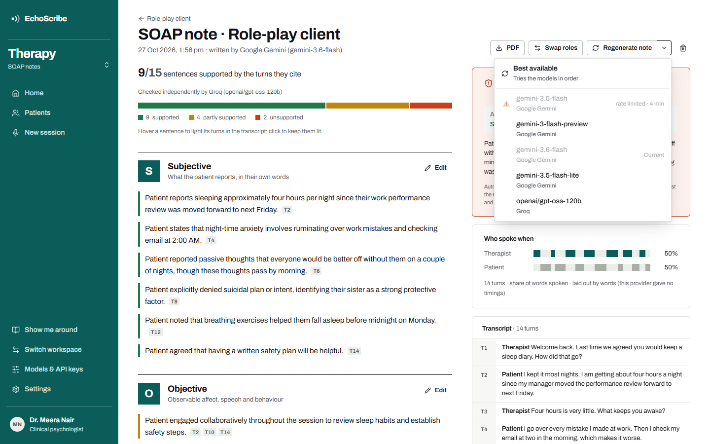<br /><sub><b>Regenerate on a model you pick.</b> The current model is greyed out; exhausted models show a warning and cannot be chosen.</sub></td>
    <td align="center">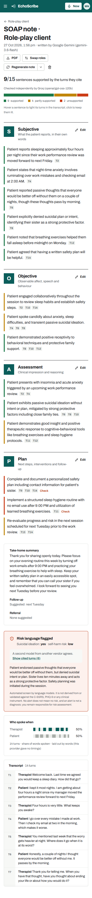&nbsp;&nbsp;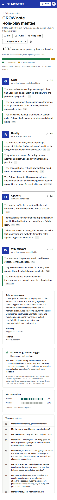<br /><sub><b>Phone-friendly.</b> SOAP and GROW notes in one column.</sub></td>
  </tr>
</table>

## How it works

<div align="center">
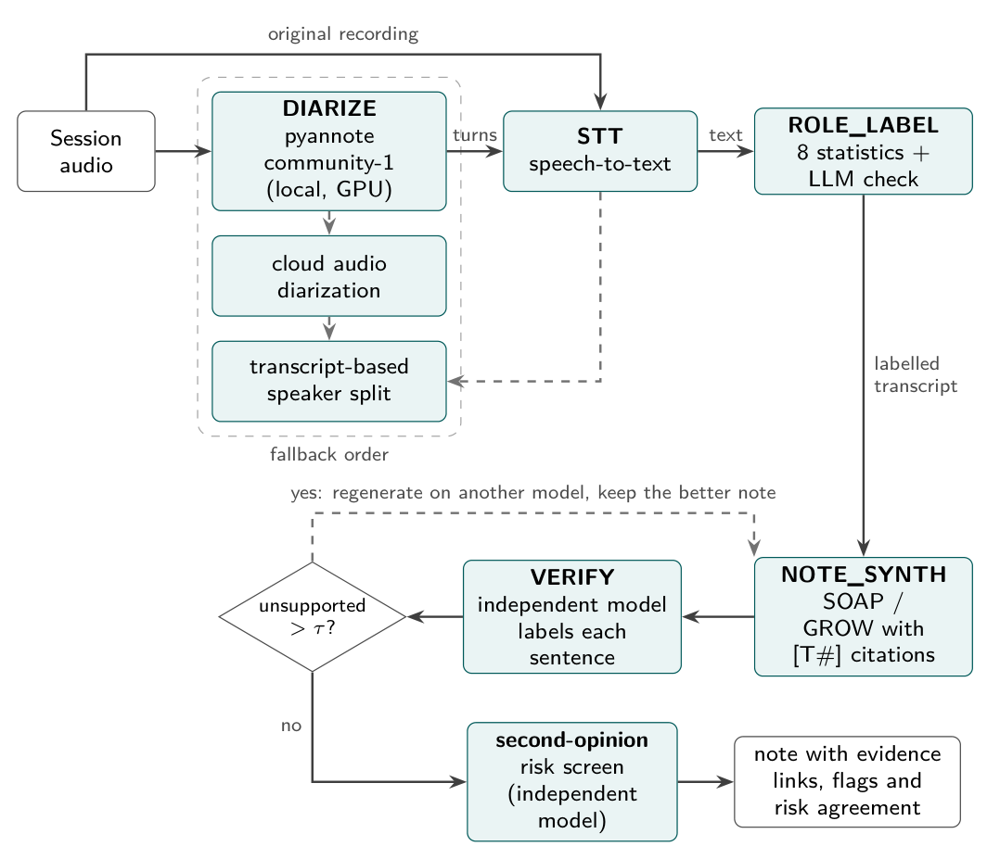
</div>

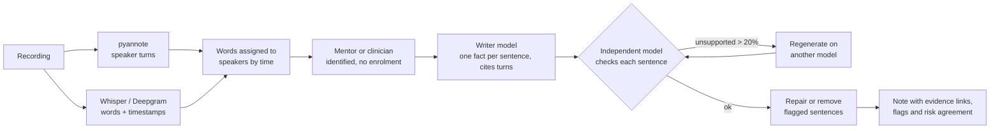

| Step | What happens | Where |
|---|---|---|
| **Separate speakers** | pyannote community-1 on the original recording (GPU if present); falls back to cloud diarization, then a transcript split | [`src/python/speech_service.py`](src/python/speech_service.py) |
| **Transcribe** | Whisper (Groq) or Deepgram with word timestamps, each word assigned to a speaker by its time | [`src/services/alignment.js`](src/services/alignment.js) |
| **Identify roles** | eight conversation statistics plus a model check, no voice enrolment | [`src/services/ai.service.js`](src/services/ai.service.js) |
| **Write** | one fact per sentence, each ending with the turns that support it | [`src/services/ai.service.js`](src/services/ai.service.js) |
| **Verify** | an independent model labels every sentence *supported*, *partial* or *unsupported*, seeing only its cited turns | [`src/services/grounding.js`](src/services/grounding.js) |
| **Repair** | flagged sentences are rewritten from the transcript or removed; a second judge must agree before a flag stands | [`src/services/grounding.js`](src/services/grounding.js) |
| **Risk screen** | a second model screens independently; disagreement is shown, never hidden | [`src/services/ai.service.js`](src/services/ai.service.js) |
| **Route** | per-key cooldowns, a vendor breaker and six strategies keep each role up | [`src/services/routing/`](src/services/routing) |

## Results

All numbers are produced by the scripts in [`eval/`](eval), from public data and role-played recordings; the result files are in [`eval/results/`](eval/results).

| Question | Result |
|---|---|
| Does citing evidence help? (ACI-Bench, 40 dialogues, same writer) | Unsupported sentences fall from **11.2% to 5.0%** against a single-pass note, with no loss of ROUGE or BERTScore |
| Does one-fact-per-sentence plus repair help? (held-out judge from another vendor) | Supported **79.1% → 88.5%**, unsupported **7.1% → 3.2%**; paired per-note gain 9.45 points (95% CI 6.2–12.8) |
| Does the verifier catch errors? | **98%** of 109 planted errors flagged; 9% false alarms on unchanged sentences |
| Speaker-attributed word error, simulated speech (clean) | **43.4% → 2.6%** with pyannote and word timestamps |
| Same, on 57 real mock consultations (PriMock57) | **53.0% → 23.8%** by using word time instead of duration |
| Who is the clinician? (no enrolment) | 57/57 PriMock57, 39/40 ACI-Bench, 40/40 AnnoMI counselling |
| Does routing help? (fault-injection simulation) | 95th-percentile latency **31.7 s → 9.1 s** with last-known-good routing |
| Mentoring sessions (23 role-played, 309 min) | Two speakers and roles found, GROW notes complete, in every session |

Limits that matter: support labels come from a model, the mentoring sessions are acted and share personas, no human has
rated GROW content yet, and the risk screen is not validated against clinician labels. These limits apply to every number above.

## Model providers

26 vendors ship as adapters ([`provider-catalog.js`](src/services/provider-catalog.js)), including Google Gemini, Groq
(gpt-oss-120b and Whisper), OpenRouter, Mistral, Deepgram and a local Ollama. Everything runs on **free tiers**:
OpenRouter is restricted in code to `:free` models and paid models are refused.

Each processing role (`STT`, `DIARIZE`, `ROLE_LABEL`, `NOTE_SYNTH`, `VERIFY`) is served by a *combo*: an ordered list of
models and keys with a strategy (`priority`, `round-robin`, `random`, `strict-random`, `least-used`, `lkgp`). A key that
fails authentication is retired, a rate-limited key cools down exponentially, and a vendor that keeps failing is skipped
for a while. The routing logic is adapted from [OmniRoute](https://github.com/diegosouzapw/OmniRoute) (MIT); see
[THIRD_PARTY_NOTICES.md](THIRD_PARTY_NOTICES.md).

## Quick start

```bash
git clone https://github.com/Aravind-Krishnan-S/ECHOSCRIBE.git
cd ECHOSCRIBE
cp .env.example .env        # add your Supabase URL and key; AI provider keys are optional
npm install
npm run build               # builds the web app
npm run speech              # optional: local speaker separation (see SETUP.md for the Python environment)
npm start                   # http://localhost:3000
```

Full instructions, including the database setup and GPU notes, are in [SETUP.md](SETUP.md).

## Tech stack

| Layer | Technology |
|---|---|
| Web app | React 19, TypeScript, Vite, Tailwind CSS v4, TanStack Query, Motion |
| Server | Node.js, Express, Zod, Helmet, JWT |
| Data | Supabase (PostgreSQL with Row-Level Security, Auth, Storage) |
| Speech | pyannote.audio 4 (community-1), PyTorch 2.8, FastAPI; Whisper via Groq; Deepgram |
| Language models | Gemini, Groq-hosted gpt-oss-120b, OpenRouter free models, Mistral and others, through the embedded router |

## Repository layout

```text
src/                 server: routes, controllers, services (router, grounding, alignment), speech service
  services/routing/    cooldowns and routing strategies (adapted from OmniRoute)
  python/              pyannote speech service (FastAPI, port 5050)
frontend/            React web app
eval/                every experiment: scripts, result files, rater kits
supabase/            SQL for the database and migrations
docs/images/         screenshots and the pipeline diagram used in this README
api/                 Vercel entry point
```

## API

Public: `POST /api/auth/signup | login | refresh`. Everything else needs `Authorization: Bearer <token>`. Interactive
documentation is served at `/api/docs`.

| Area | Routes |
|---|---|
| Account | `GET/PUT /api/auth/profile`, `POST /api/auth/avatar`, `POST /api/auth/password` |
| Pipeline | `POST /api/transcribe-audio`, `/api/identify-speakers`, `/api/diarize-transcript`, `/api/summarize` |
| Sessions | `GET /api/history`, `GET/PUT/DELETE /api/session/:id`, `POST /api/session/:id/regenerate`, `GET /api/session/:id/audio` |
| Clients | `GET/POST /api/patients`, `GET/PUT/DELETE /api/patients/:id` |
| Export | `GET /api/export/pdf/:sessionId`, `/api/export/csv`, `/api/export/record` |
| Providers | `GET /api/providers`, `GET /api/providers/status`, `POST /api/providers/test`, `GET/POST/DELETE /api/providers/keys` |

## Reproducing the evaluation

```bash
node eval/run_router_sim.js                # router fault-injection grid
node eval/ablation_notes.js 40 test1       # note-quality experiment on ACI-Bench (needs provider keys)
```

Each script in [`eval/`](eval) starts with a usage line. Datasets are downloaded into `eval/data/` (git-ignored). The
[`eval/team_kit/`](eval/team_kit) folder holds the blinded rating forms and the role-play protocol used to record
mentoring sessions.

## Responsible use

- **Do not use real patient or mentee data with free-tier keys.** Those vendors may use submitted text for training. Use
  role-played or public audio, or configure vendors your institution has approved, or local models.
- Risk flags are a second opinion from language models, not a validated instrument such as the C-SSRS or PHQ-9.
- Recording a session needs the consent of everyone in it.
- Therapy and mentoring records are separated per user by Row-Level Security and by a mode column every query must state.

Security reports: see [SECURITY.md](SECURITY.md).

## Citation

If you use EchoScribe, please cite it (see also [`CITATION.cff`](CITATION.cff)):

```bibtex
@misc{echoscribe2026,
  title  = {EchoScribe: An AI-Powered Clinical Documentation Platform with Multi-Provider Speech Processing,
            Speaker Diarization, and Intelligent SOAP/GROW Note Generation},
  author = {Krishnan S, Aravind and Krishna M, Parvathy and B, Angisha and Sebastian, Lloyd and A, Jayakrishnan},
  year   = {2026},
  url    = {https://github.com/Aravind-Krishnan-S/ECHOSCRIBE}
}
```

## Authors

Aravind Krishnan S, Parvathy Krishna M, Angisha B, Lloyd Sebastian and Jayakrishnan A, Department of Artificial
Intelligence and Data Science, Jyothi Engineering College, Cheruthuruthy, Kerala, India.

The authors used Claude (Anthropic) to draft and revise parts of the manuscript and code; they directed and verified the
work and take responsibility for it.

## License

[MIT](LICENSE). Third-party code and models keep their own licenses: see [THIRD_PARTY_NOTICES.md](THIRD_PARTY_NOTICES.md).
